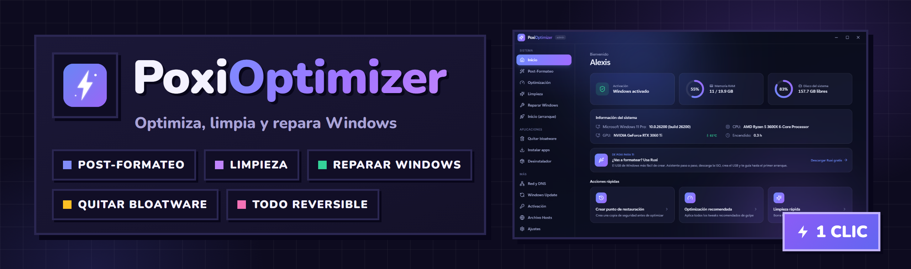
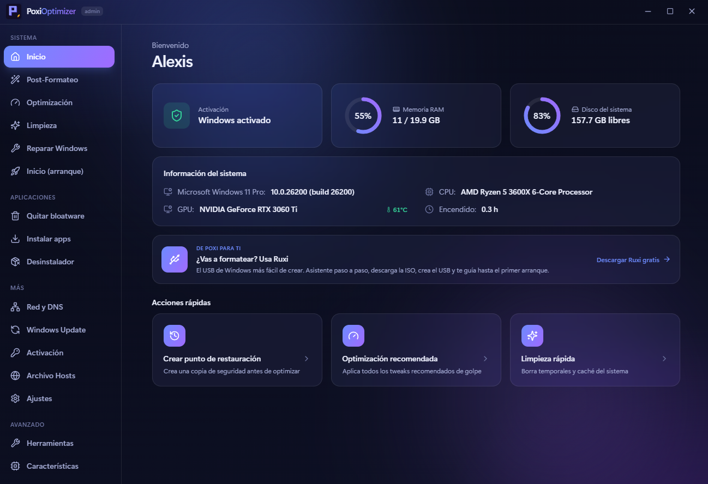

<div align="center">



<br />


**🇪🇸 Español** · [🇬🇧 English](#-english)

### Optimiza, limpia y deja Windows **a punto en un clic**.

Todo en una sola app ligera y con interfaz glassmorphism.
Tweaks seguros y reversibles, limpieza, reparación, instalador de apps y un **Post-Formateo**
que deja el PC listo tras formatear.

</div>

---

## 🎯 Qué es

**PoxiOptimizer** es un optimizador todo en uno para Windows 10 y 11. Reúne en un solo sitio lo mejor de
herramientas como *winutil* (Chris Titus) y *Optimizer* (hellzerg), y añade un **multi-desinstalador**,
un **instalador de aplicaciones**, un **menú contextual** propio y la activación de Windows y Office con
*Microsoft Activation Scripts* (massgravel). Está hecho con **Tauri 2** (Rust) y **React 19**, así que el
ejecutable es muy ligero.

## 📸 Así se ve



## 📥 Descarga

| Archivo | Para qué |
|---|---|
| **[`PoxiOptimizer_3.6.1_x64-setup.exe`](https://github.com/PoxiiTV/PoxiOptimizer/releases/download/3.6.1/PoxiOptimizer_3.6.1_x64-setup.exe)** | **Instalador** (recomendado): se instala para tu usuario y crea los accesos |
| [`PoxiOptimizer.exe`](https://github.com/PoxiiTV/PoxiOptimizer/releases/download/3.6.1/PoxiOptimizer.exe) | **Portable**: se abre tal cual, sin instalar nada. Pesa unos **3,6 MB** porque usa el WebView2 que ya trae Windows |

Todas las versiones y sus novedades, en [**Releases**](https://github.com/PoxiiTV/PoxiOptimizer/releases).

> ℹ️ Como el `.exe` aún no está firmado, Windows puede enseñar el aviso azul de SmartScreen:
> **Más información → Ejecutar de todas formas.**
>
> 🛡️ Al abrirse pide **administrador** (UAC), porque cambia ajustes del sistema.

## 🌟 Qué puede hacer

| | |
|---|---|
| 🪄 **Post-Formateo** | **Un clic para dejar el PC listo tras formatear**: punto de restauración, quita bloatware, perfil Gaming, instala tus apps, Chrome predeterminado, DNS de Google, activa Windows, Update solo seguridad y desactiva el inicio. Con progreso paso a paso |
| 🏠 **Inicio** | Panel con info del sistema (CPU, GPU, RAM, disco), estado de activación y acciones rápidas |
| ⚙️ **Optimización** | Más de **30 tweaks seguros y reversibles**, **perfiles de 1 clic** (Recomendado, Gaming, Privacidad) y una sección **Avanzado** bajo tu riesgo |
| ✨ **Limpieza** | Temporales, caché de Update y de navegadores, miniaturas, logs, cola de impresión, papelera, DNS y **WinSxS** (DISM) |
| 🔧 **Reparar Windows** | **SFC**, **DISM** (RestoreHealth) y **restablecer Windows Update** |
| 🚀 **Arranque** | Activa o desactiva los programas que arrancan con Windows |
| 🌐 **Red y DNS** | Cambia a **Google DNS** o Cloudflare con un clic |
| 🔄 **Windows Update** | Por defecto · Solo seguridad · Deshabilitado |
| 🗑️ **Quitar bloatware** | Desinstala apps de la Store. Los componentes críticos están **protegidos** |
| ⬇️ **Instalar apps** | Catálogo de más de **50 programas** y **buscador de winget en vivo** |
| 📦 **Desinstalador** | Lista **todos** los programas y los desinstala en lote |
| 🔑 **Activación** | Activa Windows (HWID) y Office (Ohook) con **MAS** y muestra el resultado en español |
| 📝 **Hosts** | Gestor del archivo hosts. Bloquea rastreadores, telemetría de Microsoft y más con un clic |
| 🧰 **Herramientas del sistema** | Acceso con un clic a **18 herramientas** de administración de Windows (Administrador de tareas, Registro, Firewall, Gestión de discos...) |
| 🧩 **Características de Windows** | Activa o desactiva características opcionales: .NET 2/3, Hyper-V, WSL, Windows Sandbox, OpenSSH y más |
| 🖱️ **Menú contextual PoxiTools** | Añade **PoxiTools ⚡** al clic derecho del escritorio y de cualquier carpeta, con **22 herramientas** sin abrir la app: reiniciar el Explorador, liberar memoria, vaciar DNS, copiar IP, apagar pantalla, bloquear pantalla, plan de energía y más |
| 🗂️ **Dos submenús** | Las herramientas se reparten en **Sistema** (Sistema · Limpieza · Red) y **Utilidades** (Pantalla · Herramientas), para no chocar con el límite de altura del menú de Windows |
| 🔕 **Silencioso** | Cada acción se ejecuta en segundo plano, sin ventana negra, y avisa con una **notificación nativa** de Windows al terminar |
| ☑️ **A tu medida** | Elige qué herramientas salen en el menú con casillas y pulsa **Guardar y aplicar**. Se recuerda entre sesiones |
| 🪟 **Menú clásico** | Un interruptor para usar el menú contextual clásico en Windows 11, así PoxiTools sale siempre sin pulsar «Mostrar más opciones» |
| 💾 **Configuración** | **Exportar e importar** ajustes, **historial de acciones** con deshacer, **copia del registro** y comprobar actualizaciones |

## 🚀 Cómo se usa

1. Descarga el instalador o el portable y ábrelo.
2. Acepta el aviso de administrador.
3. Crea un **punto de restauración** y elige un módulo en la barra lateral: un perfil de 1 clic, la limpieza o el **Post-Formateo** si acabas de formatear.

> 💡 Cada tweak se puede desactivar igual que se activa, y desde **Configuración** puedes deshacer acciones del historial.

## ⚠️ Avisos

- **Todos los tweaks son reversibles**: lo que activas, lo puedes desactivar.
- Crea un **punto de restauración** con un clic antes de optimizar.
- Los **componentes críticos están protegidos**: no se puede romper el menú Inicio, la tienda ni la seguridad.
- Solo ajustes conocidos y probados. Lo de la sección **Avanzado** es bajo tu riesgo.
- Se ejecuta como **administrador** (UAC) para poder aplicar los cambios.
- La activación descarga y ejecuta el script oficial de **MAS** (proyecto open source de terceros). Úsala bajo tu responsabilidad. PoxiOptimizer no aloja ni modifica ese script.
- La app **no se actualiza sola**: avisa si hay versión nueva y te ofrece abrir la página de descargas.

## 🔧 Compilar

Necesitas [Node.js](https://nodejs.org), [Rust](https://rustup.rs) y las *Build Tools* de Visual Studio (C++).

```bash
npm install
npm run tauri dev      # modo desarrollo (o start.bat)
npm run tauri build    # instalador en src-tauri/target/release/bundle
```

## 📋 Novedades

Lo nuevo de cada versión está en el [**CHANGELOG**](CHANGELOG.md). La 3.6.1 estrena icono, y la 3.6.0 trajo el menú contextual PoxiTools.

## 📜 Licencia

[PolyForm Noncommercial 1.0.0](LICENSE) · © 2026 Poxi

Libre para **uso personal**: optimizar y mantener tu Windows, aprender y experimentar.
Prohibido el **uso comercial**: no se puede vender ni sacar beneficio económico con este proyecto.

Inspirado en [winutil](https://github.com/christitustech/winutil) · [Optimizer](https://github.com/hellzerg/optimizer) · [Microsoft Activation Scripts](https://github.com/massgravel/Microsoft-Activation-Scripts).

---
<br />

<a id="-english"></a>

<div align="center">

**[🇪🇸 Español](#)** · **🇬🇧 English**

### Optimize, clean and get Windows **ready in one click**.

Everything in one lightweight app with a glassmorphism interface.
Safe, reversible tweaks, cleanup, repair, an app installer and a **Post-Format** mode
that sets up your PC after a fresh install.

</div>

## 🎯 What it is

**PoxiOptimizer** is an all-in-one optimizer for Windows 10 and 11. It brings together the best of tools
like *winutil* (Chris Titus) and *Optimizer* (hellzerg), and adds a **multi-uninstaller**, an
**app installer**, its own **context menu** and Windows and Office activation through
*Microsoft Activation Scripts* (massgravel). It is built with **Tauri 2** (Rust) and **React 19**,
so the executable is very light.

## 📸 Screenshot


## 📥 Download

| File | What for |
|---|---|
| **[`PoxiOptimizer_3.6.1_x64-setup.exe`](https://github.com/PoxiiTV/PoxiOptimizer/releases/download/3.6.1/PoxiOptimizer_3.6.1_x64-setup.exe)** | **Installer** (recommended): installs for your user and creates shortcuts |
| [`PoxiOptimizer.exe`](https://github.com/PoxiiTV/PoxiOptimizer/releases/download/3.6.1/PoxiOptimizer.exe) | **Portable**: runs as is, nothing to install. About **3.6 MB** because it uses the WebView2 that Windows already has |

All versions and release notes live in [**Releases**](https://github.com/PoxiiTV/PoxiOptimizer/releases).

> ℹ️ The `.exe` is not code-signed yet, so Windows may show the blue SmartScreen warning:
> **More info → Run anyway.**
>
> 🛡️ It asks for **administrator** rights (UAC) on launch, because it changes system settings.

## 🌟 What it can do

| | |
|---|---|
| 🪄 **Post-Format** | **One click to set up your PC after a fresh install**: restore point, remove bloatware, Gaming profile, install your apps, Chrome as default, Google DNS, activate Windows, security-only Update and disable startup apps. With step-by-step progress |
| 🏠 **Home** | Dashboard with system info (CPU, GPU, RAM, disk), activation status and quick actions |
| ⚙️ **Optimization** | Over **30 safe, reversible tweaks**, **1-click profiles** (Recommended, Gaming, Privacy) and an **Advanced** section at your own risk |
| ✨ **Cleanup** | Temp files, Update and browser cache, thumbnails, logs, print queue, recycle bin, DNS and **WinSxS** (DISM) |
| 🔧 **Repair Windows** | **SFC**, **DISM** (RestoreHealth) and **reset Windows Update** |
| 🚀 **Startup** | Enable or disable the programs that launch with Windows |
| 🌐 **Network and DNS** | Switch to **Google DNS** or Cloudflare in one click |
| 🔄 **Windows Update** | Default · Security only · Disabled |
| 🗑️ **Remove bloatware** | Uninstalls Store apps. Critical components are **protected** |
| ⬇️ **Install apps** | Catalog of over **50 programs** and **live winget search** |
| 📦 **Uninstaller** | Lists **every** program and removes them in batch |
| 🔑 **Activation** | Activates Windows (HWID) and Office (Ohook) through **MAS** and shows the result in Spanish |
| 📝 **Hosts** | Hosts file manager. Block trackers, Microsoft telemetry and more in one click |
| 🧰 **System tools** | One-click access to **18 Windows admin tools** (Task Manager, Registry Editor, Firewall, Disk Management...) |
| 🧩 **Windows features** | Enable or disable optional features: .NET 2/3, Hyper-V, WSL, Windows Sandbox, OpenSSH and more |
| 🖱️ **PoxiTools context menu** | Adds **PoxiTools ⚡** to the right-click menu of the desktop and any folder, with **22 tools** without opening the app: restart Explorer, free memory, flush DNS, copy IP, turn off screen, lock screen, power plan and more |
| 🗂️ **Two submenus** | Tools are split into **System** (System · Cleanup · Network) and **Utilities** (Display · Tools), to stay under the Windows menu height limit |
| 🔕 **Silent** | Every action runs in the background, with no black window, and shows a **native Windows notification** when done |
| ☑️ **Your way** | Pick which tools appear in the menu with checkboxes and press **Save and apply**. Remembered between sessions |
| 🪟 **Classic menu** | One switch to use the classic context menu on Windows 11, so PoxiTools always shows without clicking «Show more options» |
| 💾 **Configuration** | **Export and import** settings, **action history** with undo, **registry backup** and update check |

## 🚀 How to use it

1. Download the installer or the portable and open it.
2. Accept the administrator prompt.
3. Create a **restore point** and pick a module in the sidebar: a 1-click profile, cleanup or **Post-Format** if you just reinstalled.

> 💡 Every tweak can be turned off the same way it was turned on, and **Configuration** lets you undo actions from the history.

## ⚠️ Notices

- **Every tweak is reversible**: what you enable, you can disable.
- Create a **restore point** in one click before optimizing.
- **Critical components are protected**: the Start menu, the Store and security can't be broken.
- Only well-known, tested settings. The **Advanced** section is at your own risk.
- It runs as **administrator** (UAC) so it can apply the changes.
- Activation downloads and runs the official **MAS** script (third-party open source project). Use it at your own risk. PoxiOptimizer does not host or modify that script.
- The app **does not update itself**: it tells you about a new version and offers to open the downloads page.

## 🔧 Building

You need [Node.js](https://nodejs.org), [Rust](https://rustup.rs) and the Visual Studio C++ *Build Tools*.

```bash
npm install
npm run tauri dev      # development (or start.bat)
npm run tauri build    # installer in src-tauri/target/release/bundle
```

## 📋 What's new

Every version's changes are in the [**CHANGELOG**](CHANGELOG.md). 3.6.1 brings a new icon, and 3.6.0 added the PoxiTools context menu.

## 📜 License

[PolyForm Noncommercial 1.0.0](LICENSE) · © 2026 Poxi

Free for **personal use**: optimize and maintain your Windows, learn and experiment.
**Commercial use** is not allowed: you can't sell this project or make money from it.

Inspired by [winutil](https://github.com/christitustech/winutil) · [Optimizer](https://github.com/hellzerg/optimizer) · [Microsoft Activation Scripts](https://github.com/massgravel/Microsoft-Activation-Scripts).
